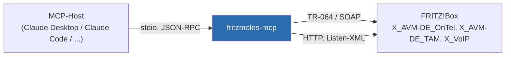

# fritzmoles-mcp

[](https://github.com/the78mole/fritzmoles-mcp/actions/workflows/test.yml)
[](https://github.com/the78mole/fritzmoles-mcp/actions/workflows/pypi-publish.yml)
[](https://pypi.org/project/fritzmoles-mcp/)
[](LICENSE)
[](https://renovatebot.com)
[](https://github.com/astral-sh/uv)
[](https://github.com/astral-sh/ruff)

Ein [MCP](https://modelcontextprotocol.io)-Server, der KI-Assistenten (z. B. Claude) Zugriff auf die
**Telefonie-Funktionen einer FRITZ!Box** gibt: Anruflisten (ein-/ausgehend/verpasst), Anrufbeantworter
und Sprachnachrichten, Rufsperren, Rufumleitungen und Telefonbuch-Suche. Netzwerk-Administration
(WLAN, Portfreigaben, Heimnetz, ...) ist bewusst **nicht** enthalten.

Zielgruppe: wer Claude als Assistenten fürs (Geschäfts-)Telefon nutzt — "Wer hat heute angerufen?",
"Gibt es neue Nachrichten auf dem AB?", "Sperre die Nummer 0900...", "Schalte die Rufumleitung aufs Handy ein".



Die Kommunikation läuft über die offizielle, von AVM dokumentierte
[TR-064-Schnittstelle](https://fritz.com/service/schnittstellen/) (via
[`fritzconnection`](https://github.com/kbr/fritzconnection)). Kein Scraping der Weboberfläche.
Getestet gegen eine FRITZ!Box 7490 mit FRITZ!OS 7.62.

## Tools

### Anruflisten & Rufnummern

| Tool | Beschreibung |
|------|-------------|
| `get_call_list` | Anrufliste, filterbar nach `kind` (`all`, `incoming`, `missed`, `outgoing`, `rejected` = durch Rufsperre abgewiesen, `active`), `days` und `max_entries`. Liefert je Anruf Typ, Datum (ISO), Rufnummern, Name aus dem Telefonbuch, Gerät, Dauer sowie Flags für Fax/AB-Anrufe. |
| `get_own_numbers` | Eigene Rufnummern (MSNs / SIP-Konten) der Box. |
| `search_phonebook` | Telefonbuch-Suche nach Namens- oder Nummernfragment (z. B. um Anrufer aufzulösen). |
| `list_phonebooks` | Vorhandene Telefonbücher (ID + Name). |

### Anrufbeantworter (TAM)

| Tool | Beschreibung |
|------|-------------|
| `list_answering_machines` | Alle Anrufbeantworter mit Status (aktiv, läuft, Restkapazität in Minuten, voll/belegt). |
| `get_answering_machine` | Details eines AB: Modus, Klingelverzögerung, zugeordnete Rufnummern. |
| `list_voicemails` | Nachrichten eines AB (optional nur neue), mit Anrufer, Name, Datum, Dauer. |
| `mark_voicemail` ✏️ | Nachricht als gelesen/ungelesen markieren. |
| `delete_voicemail` ✏️ | Nachricht löschen. |
| `download_voicemail` ✏️ | Aufnahme einer Nachricht als Datei herunterladen (Standardordner `FRITZ_DOWNLOAD_DIR`). |
| `set_answering_machine_enabled` ✏️ | Anrufbeantworter ein-/ausschalten. |

### Rufsperren

| Tool | Beschreibung |
|------|-------------|
| `list_call_barrings` | Alle gesperrten Rufnummern mit `uniqueid`. |
| `get_call_barring` | Sperreintrag zu einer Nummer nachschlagen (`blocked: false`, wenn die Nummer nicht gesperrt ist). |
| `add_call_barring` ✏️ | Eingehende Rufnummer sperren (optional mit Name). |
| `remove_call_barring` ✏️ | Sperre per `uniqueid` oder Rufnummer entfernen. |

### Rufumleitungen

| Tool | Beschreibung |
|------|-------------|
| `list_call_forwardings` | Alle Rufumleitungen mit ID, Status, Typ (z. B. alle Anrufer / bestimmte Nummer / anonyme Anrufer), Modus (sofort / bei besetzt / verzögert ...) und Zielnummer. `kind` ist `forward` oder `block`: FRITZ!OS führt über die Weboberfläche angelegte Rufsperren intern als Umleitung mit Modus "nicht signalisieren". |
| `get_call_forwarding` | Details einer Rufumleitung. |
| `set_call_forwarding_enabled` ✏️ | Rufumleitung ein-/ausschalten. |

### Wählhilfe

| Tool | Beschreibung |
|------|-------------|
| `dial_number` ✏️ | Ruf über die FRITZ!Box-Wählhilfe aufbauen (das eigene Telefon klingelt zuerst, dann wird gewählt). Wählhilfe muss in der Box aktiviert sein. |
| `hangup` ✏️ | Über die Wählhilfe gestarteten Ruf abbrechen. |

✏️ = verändert den Zustand der Box. Mit `FRITZ_READ_ONLY=true` werden diese Tools gar nicht erst registriert.

Alle Tools liefern ein Dict; im Fehlerfall `{"error": "..."}` statt einer Exception, damit der
Assistent die Ursache (falsche Zugangsdaten, fehlende Rechte, ungültiger Index, ...) lesen kann.

### Was TR-064 nicht kann

- **Rufumleitungen anlegen oder löschen.** AVM stellt per TR-064 nur `GetDeflections` /
  `SetDeflectionEnable` bereit. Regeln einmal in der Weboberfläche anlegen
  (Telefonie → Rufbehandlung → Rufumleitung), dann per Claude ein-/ausschalten.
- Rufsperren für **ausgehende** Rufnummernbereiche (0900, Ausland, ...) — TR-064 kennt nur die
  Sperrliste für eingehende Rufnummern.
- Sprachnachrichten in Text umwandeln. `download_voicemail` legt die Aufnahme als WAV-Datei ab; die
  Transkription übernimmt z. B. [holy-moly-mcp](https://github.com/the78mole/holy-moly-mcp) mit
  seinem Tool `convert_speech_to_text` (lokal per faster-whisper, kein API-Key nötig). Beide Server
  zusammen eingebunden, kann Claude den AB komplett abhören: Nachricht laden, transkribieren,
  zusammenfassen.

## Voraussetzungen auf der FRITZ!Box

1. **TR-064 aktivieren:** Heimnetz → Netzwerk → Netzwerkeinstellungen →
   "Zugriff für Anwendungen zulassen" (bei neueren FRITZ!OS-Versionen unter "Heimnetzfreigaben").
2. **Eigenen Benutzer anlegen** (System → FRITZ!Box-Benutzer) mit den Rechten
   *FRITZ!Box Einstellungen* und *Sprachnachrichten, Faxnachrichten, FRITZ!App Fon und Anrufliste*.
   Kein Admin-Vollzugriff nötig, aber das Recht "Telefonie" (Phone) ist für alle Tools Pflicht.
3. Für `dial_number`: Telefonie → Anrufe → Wählhilfe aktivieren.

## Installation

```bash
uvx fritzmoles-mcp          # einmalig ausführen / testen
# oder dauerhaft:
uv tool install fritzmoles-mcp
```

### Konfiguration (ENV oder `.env`)

Zugangsdaten kommen ausschließlich aus Umgebungsvariablen oder einer `.env`-Datei im
Arbeitsverzeichnis (siehe [`.env.example`](.env.example)). Gesetzte Umgebungsvariablen haben
Vorrang vor `.env`.

| Variable | Pflicht | Default | Bedeutung |
|----------|---------|---------|-----------|
| `FRITZ_HOST` | nein | `fritz.box` | Hostname oder IP der Box |
| `FRITZ_USERNAME` | **ja** | – | FRITZ!Box-Benutzer |
| `FRITZ_PASSWORD` | **ja** | – | Passwort |
| `FRITZ_PORT` | nein | `49000` / `49443` | TR-064-Port (TLS-Port wird automatisch gewählt) |
| `FRITZ_TLS` | nein | `false` | HTTPS für TR-064 verwenden |
| `FRITZ_TIMEOUT` | nein | `10` | Timeout je Anfrage in Sekunden |
| `FRITZ_READ_ONLY` | nein | `false` | `true` → nur lesende Tools registrieren |
| `FRITZ_DOWNLOAD_DIR` | nein | `~/fritz-voicemails` | Zielordner für `download_voicemail` |

### Claude Code

```bash
claude mcp add --scope user fritzmoles \
  -e FRITZ_HOST=fritz.box -e FRITZ_USERNAME=... -e FRITZ_PASSWORD=... \
  -- uvx fritzmoles-mcp
```

Wer die Zugangsdaten nicht in `~/.claude.json` haben möchte, registriert stattdessen ein kleines
Wrapper-Skript, das `FRITZ_*` aus einem Secret-Store (z. B. OpenBao/Vault, KeePass, `pass`)
exportiert und dann `exec uvx fritzmoles-mcp` aufruft.

### Claude Desktop

`claude_desktop_config.json` (siehe [`mcp.example.json`](mcp.example.json)):

```json
{
  "mcpServers": {
    "fritzmoles": {
      "command": "uvx",
      "args": ["fritzmoles-mcp"],
      "env": {
        "FRITZ_HOST": "fritz.box",
        "FRITZ_USERNAME": "fritz1234",
        "FRITZ_PASSWORD": "..."
      }
    }
  }
}
```

## Entwicklung

```bash
git clone https://github.com/the78mole/fritzmoles-mcp.git
cd fritzmoles-mcp
uv sync --extra dev
uv run pytest                 # Unit-Tests mit Coverage (ohne Box, über eine Fake-Verbindung)
uv run ruff check . && uv run ruff format .
pre-commit install
```

Gegen eine echte Box testen:

```bash
cp .env.example .env          # Zugangsdaten eintragen
uv run mcp dev src/fritzmoles_mcp/server.py   # MCP Inspector
```

Siehe [CONTRIBUTING.md](CONTRIBUTING.md) für Commit-Konventionen (Conventional Commits steuern die
automatische Versionierung) und den Release-Ablauf.

## Lizenz

[MIT](LICENSE) — Daniel Glaser
